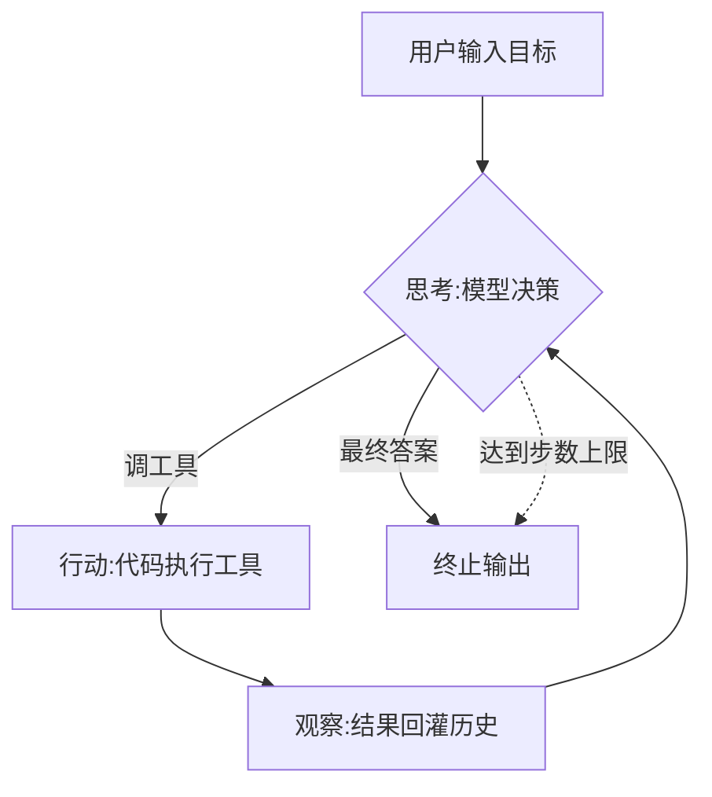

# K01 Agent 概念与定义（对应执行阶段 P1）

> 本章建立 Agent 的统一心智模型：它不是一个函数调用，而是一个"感知—思考—行动—观察"的闭环。学完立刻进入 `项目教学区_Labs/L01_最小AgentLoop/` 动手印证。

## 一、学习目标
学完你能：
1. 用自己的话定义什么是 Agent，并说清它与脚本 / chatbot / RPA / 确定性工作流的区别与边界；
2. 描述 Agent Loop（感知—思考—行动—观察）四环节，指出哪一环由模型决定、哪一环由代码执行；
3. 画出最小闭环，并说明"终止条件"为什么是双保险（最终答案 + 步数上限）；
4. 列举至少 3 类**不该**用 Agent 的任务（边界意识，避免为用而用）；
5. 运行 L1 的最小 Agent Loop，读懂 Trajectory，并解释成本护栏为何要内置。

## 二、核心概念（概念卡）

> **Agent（智能体）** = 在环境中**自主感知、思考、行动以达成目标**的软件系统；核心特征是"闭环"——不是一次性函数调用，而是"看结果→再决策→再行动"的循环。

- **闭环（Loop）**：Agent 区别于"一次函数调用"的根本。哪怕只循环一次，只要有"决策→执行→回收结果→再决策"的结构，就是 Agent 雏形。
- **Agent vs 脚本**：脚本是固定的 `if/else` 流程；Agent 的下一步行动由模型在运行时**动态决定**。
- **Agent vs chatbot**：chatbot 多半只生成文本；Agent 能"动手"调用工具改变外部状态（查天气、算数、写文件）。
- **Agent vs RPA**：RPA 按录制好的固定步骤操作界面；Agent 能应对未见过的情形、做决策。
- **Agent vs 确定性工作流**：工作流（如 Airflow/Dagster 的 DAG）步骤与分支写死；Agent 的分支由模型**推理**得出。两者不是替代关系，见第五节"何时不该用 Agent"。
- **Agent Loop 四环节**：感知(Perceive) → 思考(Think/Reason) → 行动(Act) → 观察(Observe) → 回到思考，直到满足终止条件。
- **自主性谱（2025 视角）**：从"完全确定性脚本"到"完全自主多 Agent"是连续谱；多数生产系统落在中间——**人在环（HITL）**、**工具受控**、**步骤可回放**。本教学 `agent_core` 默认"受控自主"：模型决策但代码执行、每步可观测。

## 三、工作原理



最小闭环伪代码：

```
目标 = 用户输入
循环（最多 N 步）：
    思考 = 模型(历史 + 目标)        # 决定：调哪个工具，还是直接回答
    如果 思考 是"最终答案"：返回并终止
    否则：执行 思考.动作(工具) → 得到 观察
    把 观察 加入历史                # 关键：观察必须回灌，否则闭环断裂
返回 最终答案
```

三条铁律：① 模型只出决策、代码出结果（安全可控）；② 观察必须回灌（闭环不断）；③ 终止必须双保险（最终答案 **OR** 步数上限，否则烧钱死循环）。L1 用 `MockLLMClient` 离线决策器先把这条链路跑通，再谈接真模型——你会在 L1 看到成本护栏（`usage.cost`）已被内置统计。

## 四、主流方案与 2025–2026 现代形态

**经典范式（本教学逐章展开）**
- **ReAct / Plan-and-Execute**：交替推理与行动，或先规划再执行（K5 推理与规划）。
- **反思与自评**：执行后 critic 修正（K6）。
- **多智能体协作**：规划者/执行者/评审者消息传递（K7）。
- **RAG 检索增强**：把知识接地到外部语料（K8）。

**接入与封装（2024–2025 协议化浪潮）**
- **MCP（Model Context Protocol）**：用统一协议把"外部工具/资源"接进来，换工具源不影响 Agent 代码（K9）。
- **Skill（能力模块）**：把"提示+工具+流程"打包成可发现、按需加载的能力单元（K10）。

**编排与治理**
- **编排框架**：用图/状态机把上面模块串成流水线（K11）。
- **评估与安全**：轨迹/评分/成本/护栏（K12）。

**2025–2026 实务（必读）**
- **Agent 不是"一个产品"，而是一种范式**：2025 主流落地形态是**编码 Agent**（Claude Code / Codex）、**computer use**（操作 GUI）、**deep research**（多步检索+交叉验证）、**agentic RAG**（检索本身由 Agent 规划）、**多 Agent 编排**（角色分工）。
- **协议标准化**：MCP（2024 末起）把"工具接入"从各厂私有变成开放标准；A2A（Agent-to-Agent）补"Agent 互操作"一块。理解 K9/K10 就是理解这套新底座。
- **Context Engineering（上下文工程）**：2025 共识——"会组装上下文"比"会写一条 prompt"更重要：动态挑选记忆(K4)、检索(K8)、工具 schema(K3/K9) 注入，比无脑堆长上下文有效。
- **成本与可观测是一等公民**：生产 Agent 必带 token 计数、成本上限、轨迹回放（K12）。本教学从 L1 起就把 `usage` 内置于 `LLMClient`。

## 五、常见陷阱
1. **把"调一次 LLM"当成 Agent**——没有循环就不是 Agent。
2. **工具结果不回灌**——观察没喂回模型，模型看不到执行结果，闭环断了。
3. **没有终止条件**——无限循环烧钱；必须有"最终答案"或"步数上限"双保险。
4. **让模型直接出结果而不是出决策**——模型只该决定"调什么、填什么参数"，执行与求值由代码负责（安全、可控）。
5. **把确定性工作流硬说成 Agent**——步骤写死、无模型动态分支时，用 DAG 工作流更便宜可靠；别为"Agent"而 Agent。
6. **盲目上多 Agent**——单 Agent + 子程序往往够用；多 Agent 带来上下文隔离与协调成本（K7 深入）。
7. **忽视成本/可观测**——上线前没埋点，出问题无法定位、烧钱无上限。
8. **混淆 Agent 与 RAG**——RAG 是"知识接地"手段，Agent 是"自主循环"范式；RAG 可嵌入 Agent（K8），但不是同一层。

## 六、自检题
1. 用一句话区分 Agent 与 chatbot。
2. Agent Loop 四环节是什么？哪个由模型决定、哪个由代码执行？
3. 为什么必须设置步数上限？若工具返回错误，观察该怎么处理才不中断循环？
4. 列出 3 类**不该**用 Agent、用确定性工作流更合适的任务，并说明理由。
5. （开放题）设计"帮用户订咖啡"的最小 Agent：① 它会循环几次？② 工具返回"门店已打烊"这种失败观察时，循环该如何健壮地处理（重试 / 换策略 / 终止）？画出你的闭环并说明。

## 七、动手引子
→ 进入 `项目教学区_Labs/L01_最小AgentLoop/`，运行 `python loop.py`，看 Agent 如何在 ≤N 步内自主循环、打印 Thought / Action / Observation 轨迹与成本。跑通后再回看上面的"常见陷阱"，你会更清楚每条为什么重要。
