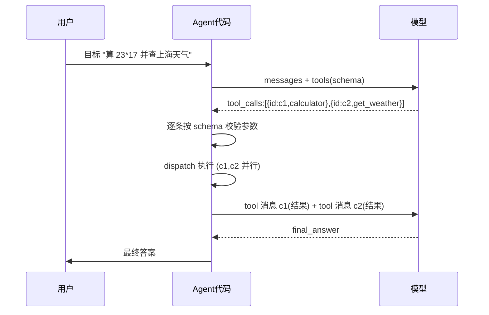

# K03 工具调用 Function Calling（对应执行阶段 P2，前置 K2）

> 本章把 L1 的"手写 JSON 决策"升级为工业级协议：让模型返回结构化的 `tool_calls`（工具名 + 合规参数），由代码安全执行。学完进入 `项目教学区_Labs/L03_工具调用实战/` 动手实现。

## 一、学习目标
学完你能：
1. 对比 Function Calling 与"让模型自由输出 JSON"的本质区别；
2. 写出合规工具描述（name / description / parameters 三要素），含 `required`、类型、枚举、嵌套结构；
3. 区分串行 / 并行调用，说清 `tool_call_id` 配对机制；
4. 列举 2025–2026 工程实务（prompt caching、tool_choice、流式 partial、成本与截断）并说明取舍；
5. 用 L3 把 `agent_core` 工具注册表接入 FC 协议，跑通单工具、并行与未知工具拒绝。

## 二、核心概念
> 概念卡：术语 = 一句话定义（边界）。

- **Function Calling** = 模型不再吐自由文本，而是按你给的"工具清单"返回结构化调用请求 `tool_calls:[{name, arguments}]`，参数符合 JSON-Schema；执行与结果仍由代码负责（安全边界不变，呼应 K1 陷阱④）。
- **Tool Use** = 与 Function Calling 同义的工程叫法（Anthropic 用 Tool Use，OpenAI 用 Function Calling，协议已趋统一）。
- **tool_call / tool_call_id** = 模型返回的一个调用单元；`tool_call_id` 是该调用的唯一标识，回灌结果时必须原样带回，供模型把"结果"匹配到"哪个调用"。
- **observation** = 你执行工具后回灌给模型的 `role=tool` 消息内容（即工具结果）。
- **schema** = 用 JSON-Schema 约束参数的 name / 类型 / 必填 / 枚举 / 嵌套；是模型"填表"的模板，也是你 dispatch 前校验的依据。
- **parallel vs sequential** = 一次回复含多个 `tool_calls` 为并行（互相独立的子任务）；需前一步结果才能定下一步则为串行（多轮）。

## 三、工作原理
1. 你把一个或多个工具描述随请求发给模型（OpenAI 格式：`tools=[{type:function, function:{name,description,parameters}}]`）。
2. 模型决定调用哪些工具，返回 `tool_calls`（含 `arguments` JSON 与唯一 `id`）。
3. 你的代码**先按 schema 校验 / 清洗**参数，再逐个 dispatch，得到 `observation`。
4. 把 `role=tool` 消息（带 `tool_call_id` / `name`）回灌，模型据此产出下一步或最终答案。

这正是 L1 循环的升级版：L1 用手写 `{action:...}` JSON，K3 用模型原生 `tool_calls` + schema 约束，解析失败率更低、工具可被发现。

**时序图（单轮并行两工具）：**



**dispatch 伪代码（Python 风格）：**

```python
def dispatch_tool_calls(tool_calls, registry, messages):
    for call in tool_calls:                     # 并行：一轮多个 call
        name, args = call.name, call.arguments
        if name not in registry:                # 陷阱：幻觉工具名 → 拒绝
            obs = Observation("未知工具", ok=False)
        else:
            args = registry.validate(name, args)  # 陷阱：先校验再执行
            obs = registry.run(name, args)
        messages.append({                       # 必须带 tool_call_id 配对
            "role": "tool", "tool_call_id": call.id,
            "name": name, "content": obs.content,
        })
    return messages
```

## 四、主流方案与工程实务
### 4.1 选型对比
| 方案 | 定位 | 优点 | 缺点 | 适用 |
|------|------|------|------|------|
| native function calling（OpenAI/Anthropic 兼容） | 模型原生返回 `tool_calls` | 解析稳、支持并行与 `tool_choice` | 依赖模型能力、需写 schema | 生产默认形态 |
| JSON mode + 自写 schema | 模型只吐合规 JSON，自解析 | 任意模型可用 | 易格式漂移、需自校验 | 无 FC 的旧模型 / 严格结构化 |
| 框架封装（LangChain Tool / MCP，见 K9） | 工具描述自动转 schema | 可复用、统一接入 | 抽象层、调试难 | 多工具 / 多源 |

### 4.2 2025–2026 实务（生产必知）
- **Prompt caching 工具定义**：`tools` schema 每次请求都随消息发送，占 input token。OpenAI/Anthropic 支持把稳定的 `tools`/`system` 前缀标记为可缓存（cache control / prompt caching），命中后该部分按缓存价计费且降延迟。**工具定义应稳定、放前缀**，避免每轮改动导致缓存失效。
- **tool_choice 控制行为**：`auto`（默认）/ `none` / `required`（强制至少调一个）/ `{"type":"function","function":{"name":...}}`（强制指定）。用于约束（如"必须先搜索再答"）。
- **tool_call_id 配对**：并行调用时每个 `tool_call` 有唯一 `id`，回灌的 `tool` 消息必须带对应 `tool_call_id`，否则 API 报错。
- **流式 partial tool call**：SSE 下 `tool_calls.arguments` 是分片到达（delta），需按 `id` 累积拼接成完整 JSON 再解析；本 Lab 离线 mock 不体现，真实接入要注意。
- **reasoning 模型与工具**：o1/o3/GPT-5 类推理模型也支持 tool use，但部分不支持 streaming tool call 或并行，需查模型卡再定方案。
- **成本与工具结果过大**：`tools` 重复发送 → 用 prompt caching；工具结果可能很大（长搜索结果 / 文件内容）→ 回灌前**截断或先摘要**，否则撑爆上下文且烧钱。

## 五、常见陷阱
1. **description 太含糊**：模型选错工具；description 要写清"何时用、输入输出是什么"。
2. **schema 不严**：缺 `required` / 类型错，模型填出不合规参数，解析崩。
3. **并行调用强顺序依赖**：把有依赖的步骤并行，结果错乱；有依赖必须串行。
4. **不校验参数就执行**：模型可能给非法值；dispatch 前必须按 schema 清洗（呼应 K1 陷阱④）。
5. **tool 结果不加 name / tool_call_id**：多工具并行时模型无法对应，上下文错乱；并行必须用 `tool_call_id` 配对。
6. **工具结果过大不截断**：长 observation 直接回灌 → token 爆炸 / 爆窗 / 烧钱；回灌前截断或摘要。
7. **tool_choice 误设**：设为 `required` 但本无需工具 → 模型空转硬造调用。
8. **幻觉工具名**：模型返回未注册工具名 → 必须拒绝执行（呼应 dispatch 校验）。
9. **把 thought/CoT 当协议字段**：真实 FC 模式模型不返回 `thought` 字段（推理隐含其中）；离线 mock 为演示塞了 `thought`，接入真 API 时勿照搬。
10. **过度拆分工具**：工具太多 → 模型选错、描述膨胀、缓存失效；按"能力边界"而非"每个动作"拆。

## 六、自检题
1. Function Calling 与"让模型输出 JSON"本质区别？
2. 工具描述三要素各起什么作用？为什么 `description` 比 `name` 更影响选型？
3. 什么场景必须串行而非并行？
4. 为什么 dispatch 前仍要校验参数？
5. （开放题）FC 与 RAG 的区别？何时该用 FC、何时该用 RAG、能否组合？
6. （开放题/设计）若把 L3 从 mock 换成真实 OpenAI API，哪些假设要改？（提示：tool_call_id、流式 partial、tool_choice、thought 字段）

## 七、动手引子
→ 进入 `项目教学区_Labs/L03_工具调用实战/`：运行 `python main.py` 看单工具 / 并行 / 搜索三轨迹；`pytest test_fc.py` 验收 schema 转换、分发、参数校验、未知工具拒绝、tool_call_id 配对。重点对照本节陷阱⑤⑨，确认代码里 tool 消息带了 `tool_call_id`、且 mock 的 `thought` 仅为离线演示。
