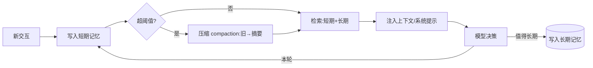

# K04 记忆（Memory）（对应执行阶段 P2）

> 本章讲 Agent 如何"记住"跨越多次交互的信息：不只是把对话塞进上下文窗口，而是分层、可检索、可遗忘、可跨会话。学完进入 `项目教学区_Labs/L04_记忆模块/` 动手印证。

## 一、学习目标
学完你能：
1. 区分短期/工作记忆与长期记忆，说出情景记忆与语义记忆的差异；
2. 解释"上下文窗口"和"记忆"不是一回事：窗口是单次可见的，记忆是可检索、可遗忘、跨会话的；
3. 画出记忆读写闭环（写入→压缩→检索注入），并说明 compaction 为什么必要；
4. 列举 2025–2026 主流记忆方案（向量库语义检索、agentic memory、MemGPT/Letta、mem0）及其取舍；
5. 在 L4 用离线 `Memory` 跑通"跨会话记住用户名"，理解长期记忆≠上下文。

## 二、核心概念（概念卡）
- **Memory（记忆）**：让 Agent 在多次交互/多步推理间保留信息的机制。没有记忆，每轮对话都是失忆的陌生人。
- **短期/工作记忆（Working Memory）**：本轮/近几轮可见的上下文窗口内容（滑窗），会随对话增长而**压缩或丢弃**——对应 K2 的 lost-in-the-middle 风险。
- **长期记忆（Long-term Memory）**：跨会话持久存储，通常按"事实/语义"或"情景/事件"组织；用检索（而非全塞）在需要时注入上下文。
- **情景记忆 vs 语义记忆**：情景=某次具体事件（"用户上周投诉过物流"）；语义=提炼后的稳定事实（"用户偏好顺丰"）。语义记忆更省 token、更抗噪。
- **上下文窗口 ≠ 记忆**：窗口是模型单次注意力可见的 token 段；记忆是**可检索、可遗忘、可跨会话**的外部存储。长上下文模型（200k+）减轻了"塞不下"，但**不解决遗忘、隐私留存、跨会话**——所以记忆独立存在。
- **记忆 vs RAG（K8）**：RAG 是"按查询检索外部语料"；记忆是"Agent 自身产生的、可写回的知识"。两者机制同构（检索→注入），可视为"Agentic RAG"——K8 会合流。
- **Agentic Memory（2025 热点）**：不让工程师写死"存什么"，而让 Agent/反思模块**自己决定**哪些经验值得长期保留、哪些该忘——典型如 reflection 生成记忆、自动摘要。

## 三、工作原理



伪代码（离线版，L4 落成）：

```
class Memory:
    short_term = 滑窗(最近 N 条)          # 工作记忆
    long_term  = 事实库 / 向量库           # 跨会话

    def add_turn(role, content): short_term.append(...)
    def compress():                        # 超限时把旧片段折叠成摘要
        if len(short_term) > N: 折叠旧段→摘要句, 保留最近 K 条
    def save_fact(key, value): long_term[key] = value     # agentic 写入
    def recall(query):                     # 检索注入
        精确匹配 → 子串回退 → (真实)向量相似度 top-k
```

三条铁律：① 短期会**压缩/丢弃**，别指望它永久；② 长期靠**检索**而非全塞——否则回到 lost-in-the-middle；③ 写入长期要**有选择**（agentic memory），否则噪声淹没信号。

## 四、主流方案与 2025–2026 实务
- **短期·滑动窗口 + Compaction**：最简单；超限时把旧对话递归摘要（"摘要的摘要"），既保信息又控 token。2025 多把 compaction 交给小模型做，主模型只看浓缩上下文。
- **长期·向量语义检索**：用 embedding 把记忆存向量库（Qdrant/Pinecone），查询时 cosine/hybrid 召回 top-k。这是 K8 RAG 的同款机制。
- **长期·事实/语义 KV 库**：把"用户偏好"等稳定事实存 key-value（或图），召回便宜、抗噪，适合语义记忆。
- **Agentic Memory（前沿）**：让模型经反思生成"该记住什么"。代表系统：
  - **MemGPT / Letta**：操作系统式分层记忆（主上下文=CPU 寄存器、外部存储=磁盘，靠"内存管理"函数自主搬移），2024–2025 持续演进。
  - **mem0**：即插即用的"记忆层"，自动抽取/去重/更新用户事实，已成为很多 Agent 栈的默认记忆组件。
- **长上下文 vs 记忆的取舍（2025 共识）**：1M token 窗口**不替代**记忆——它贵、易丢中间信息、不可跨会话、不解决隐私留存。记忆负责"可检索/可遗忘/跨会话"，长上下文负责"本轮深度推理"，两者互补。
- **Context Engineering 视角**：2025 把"记忆"重新定义为"该把哪些经验动态注入上下文"的工程问题——记忆系统即上下文的供给方（呼应 K2）。

## 五、常见陷阱
1. **无限累积不压缩**——上下文爆窗、成本飙升、lost-in-the-middle。
2. **把记忆当上下文全塞**——长期记忆全量注入 = 没记忆（噪声淹没 + 爆窗）。必须检索 top-k。
3. **遗忘策略缺失**——什么都存，噪声淹没信号；agentic memory 要会"忘"。
4. **隐私/数据留存失控**——把用户 PII 写进长期记忆且无清理，合规风险（K12）。
5. **检索噪声污染决策**——召回的无关记忆误导模型；要重排/置信过滤。
6. **跨会话污染**——A 用户记忆泄露给 B；长期记忆必须按用户/会话隔离（namespace）。
7. **过度依赖长上下文**——以为窗口大就不需要记忆，忽视跨会话与遗忘。
8. **只在 system 塞历史**——不检索、不压缩，等于把记忆问题退化成"堆上下文"。

## 六、自检题
1. 用一句话区分"上下文窗口"和"长期记忆"。
2. 情景记忆与语义记忆有何不同？各举一个 Agent 场景。
3. 为什么长期记忆要"检索注入"而非"全量塞入"上下文？
4. 列出 MemGPT/Letta 与 mem0 各自的记忆思路差异。
5. （开放题）为"客服 Agent"设计记忆分层：① 什么进短期、什么进长期？② 哪些该忘（如临时工单号）？③ 若用 agentic memory，模型凭什么决定"记住用户偏好顺丰、忘掉本次验证码"？

## 七、动手引子
→ 进入 `项目教学区_Labs/L04_记忆模块/`：
- 运行 `python loop.py` 看两件事实战：**跨会话记住用户名**（长期记忆，两次 run 共享 store）与 **短期压缩**（BufferMemory 超限折叠）；
- 打开 `memory_tools.py` 看 SaveFact/Recall 两个工具如何操作 `agent_core` 的 `LongTermMemory`；
- `pytest test_memory.py` 验收 save/recall 与 compress。
> 关键认知：第二次对话时 Agent 的上下文窗口里**没有**第一次的话，它之所以"记得"，是因为长期记忆被**检索注入**——这正是 K4 与"只堆上下文"的本质区别。
