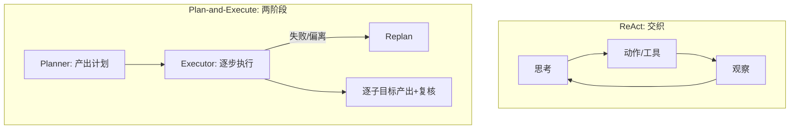

# K05 推理与规划（Reasoning & Planning）（对应执行阶段 P2）

> 本章讲 Agent 如何处理"多步、需要想清楚"的任务：是边想边做（ReAct），还是先规划再执行（Plan-and-Execute）；以及 2025–2026 推理模型（o1/o3/R1）出现后，规划层是否还有必要。学完进入 `项目教学区_Labs/L05_推理与规划/` 动手。

## 一、学习目标
1. 区分推理（Reasoning）与规划（Planning）：推理是"想清楚一步"，规划是"把任务拆成有序子目标"；
2. 说出 ReAct 与 Plan-and-Execute 的结构差异与各自适用场景；
3. 解释推理模型（o1/o3/R1）提升了"单步难推理"，但**不替代** Agent 的规划/编排层；
4. 列举 plan mode、可验证子目标、replanning on failure 等关键工程实践；
5. 在 L5 跑通一个 Plan-and-Execute 骨架，并对照 ReAct。

## 二、核心概念（概念卡）
- **Reasoning（推理）**：模型在单步内展开逻辑链（Chain-of-Thought），得出中间结论。解决"这一步该怎么想"。
- **Planning（规划）**：把整体目标拆成有序、可执行的子目标，并决定依赖/顺序。解决"整体该先做什么后做什么"。
- **ReAct**：Reasoning + Acting 交织——每步先思考（Thought），再行动（Act，调工具），再看观察（Observation），循环直到完成。边想边做，上下文随步增长。
- **Plan-and-Execute**：先让 planner 产出**完整计划**（子目标列表），再由 executor 逐步执行；执行中可 human-in-loop 复核、失败则 replan。先想清楚再动手。
- **子目标可验证性**：计划中每步最好有可验证产出（如"返回天气 JSON"），否则难判断成功、难 recovery。
- **Replanning**：执行偏离或失败时，基于当前状态重新规划，而非硬走原计划。
- **Plan Mode（2025 实务）**：如 Claude 的 plan mode——先不行动，只产出方案等人确认，避免危险/高成本误操作。

## 三、工作原理



伪代码：

```
# ReAct（K1/K3 已是此骨架）
while not done:
    thought, action = llm(messages)      # 边想边做
    obs = tool(action)
    messages += obs

# Plan-and-Execute（L5 落成）
plan = planner.plan(goal)                # 先规划
for step in plan:
    result = executor.step(step)         # 再执行
    if not verify(result): replan()      # 可验证 + 重规划
```

## 四、主流方案与 2025–2026 实务
- **ReAct 仍是 Agent 主流骨架**：thought+action+observation 的交织简单、通用，K1/K3 的 `Agent.run` 就是它。适合步骤不确定、需边做边看的任务。
- **Plan-and-Execute 的价值**：① 每步上下文更短（不必把所有历史塞进一次决策）；② 计划可被人/另一模型复核（human/auto-in-the-loop）；③ 失败时按子目标 replan，恢复成本低；④ 便于并行子目标。适合步骤清晰、可预分解的任务。
- **推理模型的冲击（关键）**：o1/o3/DeepSeek-R1/Claude 思维链类模型，把"强推理"内化进单步——它们自己会展开长 CoT。但这**不替代规划层**：推理模型擅长"难推的一步"，而 Agent 仍需规划层做**任务拆解、工具调度、状态/记忆管理、跨步编排**。结论：推理模型升级的是"单步脑容量"，规划层升级的是"全局编排"，两者互补。
- **Plan Mode**：2025 主流把"先规划不行动"做成显式模式——高风险任务先出方案等人拍板，降低误操作。
- **可验证子目标 + Replan**：长计划易漂移（LLM 健忘/跑偏），所以每步要有可验证产出（断言/测试/结构校验），失败即 replan，而非盲目续跑。
- **与 K3/K4 的关系**：规划决定"调哪些工具、按什么顺序"（K3），以及"何时写/读长期记忆"（K4）——规划是连接推理、工具、记忆的调度层。

## 五、常见陷阱
1. **计划过长不验证**——长 plan 易漂移，无 verify 就一路错到底。
2. **不 replan**——执行偏离仍硬走原 plan，浪费且出错。
3. **过度规划**——对一步能搞定的简单任务也先出详细 plan，徒增延迟/成本。
4. **把推理模型当万能**——以为 o1/o3 能自动编排多步工具，忽视仍需规划/状态层。
5. **plan 与执行上下文割裂**——执行阶段拿不到规划时的假设，子目标失去依据。
6. **子目标不可验证**——只说"做好 X"不说产出形态，无法判断是否完成。

## 六、自检题
1. 一句话区分 Reasoning 和 Planning。
2. ReAct 与 Plan-and-Execute 各适合什么任务？举一个对照例子。
3. 推理模型（o1/o3/R1）出现后，Agent 的规划层还有没有必要？为什么？
4. 什么是 plan mode？它解决了什么风险？
5. （开放题）给"订机票 + 订酒店 + 排三天行程"写一份 plan，并标注：① 哪些子目标可并行；② 每步的**可验证产出**是什么；③ 哪一步失败最需要 replan。

## 七、动手引子
→ 进入 `项目教学区_Labs/L05_推理与规划/`：
- 运行 `python loop.py` 看 **Plan-and-Execute**（Planner 先出计划 → Executor 逐步执行）与 **ReAct**（单 loop 边想边做）的对照；
- 打开 `planner.py` / `executor.py`：规划与执行解耦，执行单元可换成真 Agent/工具；
- `pytest test_plan.py` 验收计划拆分与逐步执行。
> 关键认知：ReAct 把"想"和"做"揉进一个循环；Plan-and-Execute 先把"想"独立出来成可复核的计划——当任务一复杂、或出错代价高，后者更稳。推理模型让"想"更强，但"怎么编排多步"仍要靠规划层。
