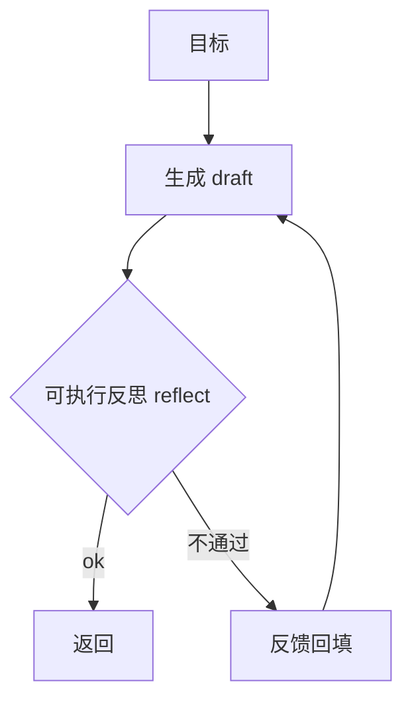

# K06 反思与自评（Reflection & Self-Evaluation）（对应执行阶段 P3，前置 K5）

> 本章讲 Agent 为什么不能"一次就信"：首次产出常有错，要靠反思/自评闭环（生成→批评→修正→再验证）提升可靠性。学完进入 `项目教学区_Labs/L06_反思与自评/` 用真实语法检查做可执行反思。

## 一、学习目标
1. 解释反思/自评为什么必要：模型单 pass 产出不可靠，需回头审视；
2. 区分"语言反馈"与"可执行反馈"，说出后者为何更可靠；
3. 描述反思循环结构（生成→批评→修正→再验证）与收敛条件；
4. 列举 2025–2026 实务（Reflexion、LLM-as-judge、self-consistency、Critic/Actor、可执行验证）；
5. 在 L6 用真实 `compile` 做可执行反思，跑通"含错代码→自检→修正"。

## 二、核心概念（概念卡）
- **Reflection（反思）**：Agent 在产出后**回头审视**自己的结果，发现缺陷并生成改进方向。
- **Self-Correction（自我修正）**：基于反思反馈修改产出，常迭代多轮。
- **Critic / Judge**：专门挑错或打分的角色（可同模型、异模型或规则）。
- **可执行反馈 vs 语言反馈**：语言反馈="你这里错了"（模型可能假装修好）；可执行反馈=用测试/编译/运行给出**确定信号**（真错真修）。**后者可靠得多**，是 K6 的关键认知。
- **Self-Consistency（自一致性）**：同一问题采样多条推理路径、多数投票，降低单路幻觉。
- **Reflexion（2023–前沿）**：语言智能体把"反思"写入长期记忆（呼应 K4），下次避开同类错误——反思即记忆的写入源之一。

## 三、工作原理



伪代码：

```
for i in range(max_iter):
    draft = generate(goal, feedback)
    ok, feedback = reflect(draft)   # 可执行验证
    if ok: return draft
# 否则达到上限，返回当前最佳
```

收敛条件：`ok` 为真，或达到 `max_iter`（防止不收敛空转，陷阱①）。

## 四、主流方案与 2025–2026 实务
- **Reflexion**：反思文本进长期记忆，跨轮/跨会话避免重蹈——与 K4 记忆直接合流；反思是"该记住什么"的重要信号源。
- **LLM-as-judge**：用强模型给产出打分/挑错（K11 评估同款）。但 judge 本身也会错，**不能当 ground truth**（陷阱⑤）。
- **可执行验证为王**：代码用编译/单测/执行；数学用符号校验；检索用命中率。比"请模型自查"可靠——破解"自我欺骗"（陷阱②）。
- **Self-Consistency**：推理题采样多路、多数投票。
- **Critic/Actor 双模型**：Actor 产、Critic 批，分离角色减少自评偏见。
- **与 K5 的关系**：plan/replan 是"事前想清楚"，reflection 是"事后复盘改"；二者构成"规划—执行—反思"闭环。

## 五、常见陷阱
1. **反思不收敛**——无限循环改不好，必须 `max_iter` 上限。
2. **自我欺骗**——模型嘴上说"已修正"实际没改；靠可执行反馈破解。
3. **只语言反思无外部验证**——幻觉自查幻觉。
4. **过度反思**——每步都反思，成本/延迟飙升。
5. **把 judge 当 ground truth**——judge 也错。
6. **反思与记忆脱节**——反思出的教训没写入长期记忆，下次再犯（应接 K4）。

## 六、自检题
1. 为什么"可执行反馈"比"语言反馈"可靠？举例说明。
2. 反思循环何时停止？不设上限会怎样？
3. Reflexion 把反思存哪里、有何好处？
4. LLM-as-judge 的局限是什么？
5. （开放题）为"让 Agent 写一段会报错的 SQL 并自检修正"设计反思闭环：① 可执行验证用什么（数据库执行 / EXPLAIN）；② 反馈如何回填生成器；③ 怎么把"常见 SQL 错误"写入长期记忆避免再犯（呼应 K4）。

## 七、动手引子
→ 进入 `项目教学区_Labs/L06_反思与自评/`：
- 运行 `python loop.py` 看 **含错代码 → 可执行反思（compile 校验）→ 修正通过** 的闭环；
- 打开 `reflector.py`：`reflect()` 用真实 `compile` 给出确定反馈，而非让模型嘴上说改好；
- `pytest test_reflect.py` 验收正确/错误代码判定与自我修正收敛。
> 关键认知：反思的价值取决于反馈是否"可执行、可验证"——能跑测试/编译的闭环，比"请模型再检查一遍"可靠得多。
