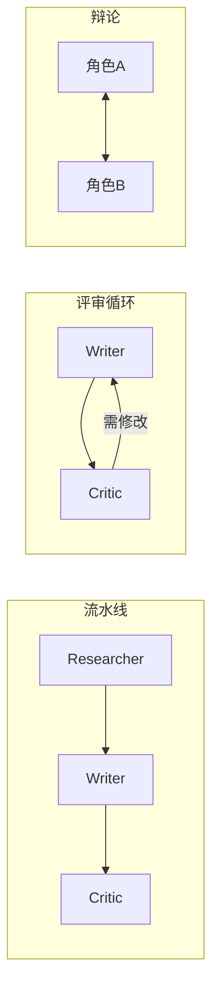

# K07 多智能体（Multi-Agent）（对应执行阶段 P4，前置 K6）

> 本章讲为什么把"一个全能 Agent"拆成多个**角色协作**：研究员/写手/评审各司其职，由编排者路由与终止。学完进入 `项目教学区_Labs/L07_多智能体协作台/` 搭三角色协作台。

## 一、学习目标
1. 说出多智能体相对"单 Agent + 子程序"的适用场景与代价；
2. 解释 role / message bus / orchestrator / handoff 各自职责；
3. 画出三种拓扑：流水线（顺序）、辩论（环形对抗）、评审（生成 + Critic）；
4. 列举 2025–2026 实务（AutoGen/CrewAI/LangGraph 多角色、角色专业化、human-in-the-loop、与 K5/K6 组合）；
5. 在 L7 用 message bus + orchestrator 跑通三角色协作产出带评审的文稿。

## 二、核心概念（概念卡）
- **Role（角色）**：专职的智能体，如 Researcher（检索/研究）、Writer（生成）、Critic（评审）。专业化降低单角色提示复杂度。
- **Message Bus（消息总线）**：角色间传递消息的媒介；角色读历史、产出自家输出并发布，彼此不直接耦合。
- **Orchestrator（编排者）**：决定"谁在何时行动"、把产出路由给下一角色、判断终止——多智能体系统的"交通指挥"。
- **Handoff（交接）**：一个角色把任务/上下文交给另一个角色继续（如 Writer 交 Critic 评审）。
- **Debate（辩论）**：多个角色对一问题多轮对抗/互补，提升推理鲁棒性（2025 热点）。
- **Review（评审）**：生成角色 + Critic 角色构成"产出→评审→修订"闭环（与 K6 反思同构）。

## 三、工作原理



伪代码（评审拓扑，L7 落成）：

```
bus = MessageBus(topic)
orchestrator.route(Researcher)   # 先研究
orchestrator.route(Writer)       # 再写稿
for _ in range(max_rounds):
    verdict = orchestrator.route(Critic)
    if verdict.pass: break
    orchestrator.route(Writer)   # 需修改则写手重修
```

## 四、主流方案与 2025–2026 实务
- **框架**：AutoGen（对话式多 Agent）、CrewAI（角色+流程）、LangGraph（图编排多节点）——本教学用纯 Python + `agent_core` 自写（design_docs：K11 前不引入重框架），机制等价。
- **角色专业化**：把"研究/写作/评审"拆开，每个角色提示更短、更易调优；Critic 与 Actor 分离也减少自评偏见（呼应 K6）。
- **Orchestrator 模式**：集中式（一个编排者路由）最常见；也有去中心化（角色自协商）。编排者内含 K5 的 planner 与 K6 的 reflector，即"规划—执行—反思"升级为多角色版。
- **Human-in-the-loop**：关键交接点（如发布前）插入人审，避免多 Agent 自说自话跑偏。
- **辩论提升推理**：让角色互相挑错/补充，常比单 Agent 更稳（但更贵）；适合高价值决策。
- **与 K5/K6 组合**：复杂系统 = 规划层（K5）拆任务 → 多角色执行（K7） → 反思/评审（K6）闭环。

## 五、常见陷阱
1. **角色冗余职责重叠**——两个角色干同一件事，协调成本白付。
2. **无明确终止条件**——评审/辩论无限循环，必须 max_rounds 或"通过"信号。
3. **各角色上下文互灌→爆炸**——把所有角色历史全塞给每个角色，token 爆炸且干扰；应只传必要上下文（handoff 精选）。
4. **过度用多 Agent**——简单任务单 Agent + 子程序更省更快；多 Agent 是"协作/专业化"溢价，不是默认选项。
5. **协调开销被低估**——消息路由、格式对齐、冲突消解都有成本。

## 六、自检题
1. 何时该用多 Agent，而非单 Agent + 子程序？
2. Orchestrator 的核心职责是什么？缺了会怎样？
3. 评审拓扑如何避免"Critic 总说不过"的僵局？
4. 为什么各角色上下文不能无脑互灌？
5. （开放题）为"产出一份带数据支撑的市场分析报告"设计三角色系统：① 三个角色怎么分工；② Orchestrator 的流程与终止条件；③ 哪里插 human-in-the-loop 最划算。

## 七、动手引子
→ 进入 `项目教学区_Labs/L07_多智能体协作台/`：
- 运行 `python loop.py` 看 **Researcher→Writer→Critic** 三角色经 message bus 协作，Critic 首轮"需修改"触发 Writer 重修，次轮"通过"；
- 打开 `message_bus.py` / `roles.py` / `orchestrator.py`：角色解耦、总线传消息、编排者路由与终止；
- `pytest test_multi.py` 验收三角色产出与评审循环收敛。
> 关键认知：多 Agent 的价值是"专业化 + 可协作"，代价是"协调开销"——别为简单任务硬上多 Agent；Orchestrator 的终止条件（max_rounds / 通过信号）是系统不失控的保险丝。
