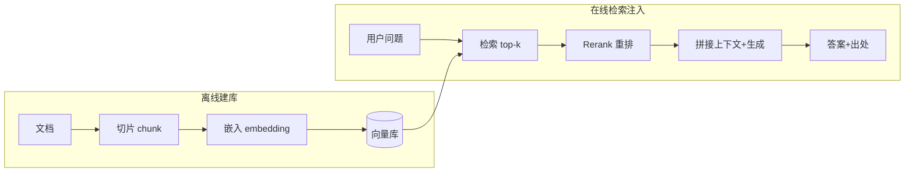

# K08 检索增强生成 RAG（Retrieval-Augmented Generation）（对应执行阶段 P5，前置 K4）

> 本章讲如何让 Agent "接地气"：回答前先从外部语料检索相关片段，注入上下文并**标注出处**。学完进入 `项目教学区_Labs/L08_检索增强生成/` 搭离线 RAG 全流程。

## 一、学习目标
1. 画出 RAG 两阶段 pipeline（离线建库 / 在线检索注入）；
2. 解释 chunk、embedding、retrieval、rerank、query rewrite、citation 各自作用；
3. 说出 2025–2026 实务：hybrid 检索、cross-encoder 重排、HyDE/sub-query、出处标注、与长上下文的取舍；
4. 指出 RAG 与 K4 记忆的关系（机制同构，一个查外部语料、一个查自身经验）；
5. 在 L8 跑通"切片→检索→生成+标注出处"的离线全流程。

## 二、核心概念（概念卡）
- **Chunk（切片）**：把长文档切成可检索的片段；过大噪声多、过小缺上下文。
- **Embedding（嵌入）**：把文本映射成向量，使语义相近者向量相近；检索的基石。
- **Retrieval（检索）**：query → 在向量库/索引中找回 top-k 相关片段。dense（向量）/ sparse（BM25）/ **hybrid**（两者结合，2025 共识更稳）。
- **Rerank（重排）**：用 cross-encoder 对初检结果精排，提升精度（初检广、重排准）。
- **Query Rewrite / HyDE / Sub-query**：改写查询、用假设答案检索、拆多子查询，缓解"问法不匹配"。
- **Citation（出处标注）**：生成时附上引用片段 id/来源——**不标注则幻觉难查**（陷阱③）。
- **Grounded Generation（接地生成）**：答案必须基于检索内容，而非模型自有知识瞎编。

## 三、工作原理



伪代码：

```
# 离线
for doc in corpus: index.embed_and_store(chunk(doc))
# 在线
hits = rerank(retrieve(embed(query), k=20), k=3)
answer = llm(question, context=hits.texts, cite=hits.ids)
```

## 四、主流方案与 2025–2026 实务
- **Chunk 策略**：固定窗口+重叠保连贯，或语义切分（按标题/段落）；长度需匹配检索粒度与生成上下文预算。
- **Hybrid 检索**：BM25（关键词）+ 向量（语义）融合，比 pure dense 更抗生僻词/专有名词——2025 已成默认。
- **Rerank**：初检用便宜的向量/BM25 取 20~50，再用 cross-encoder 精排到 3~5，精度与成本平衡。
- **Query 改写**：HyDE（先生成假设答案再检索其嵌入）、sub-query 分解复杂问题，显著提升召回。
- **出处标注 / Grounded Gen**：答案必须带来源 id；2025 强调"可验证"——否则 RAG 退化成带检索的幻觉。
- **长上下文 vs RAG（2025 共识）**：1M 窗口**不替代** RAG——RAG 提供可验证出处、可控成本、可热更新知识；长上下文适合"本轮深读"，RAG 适合"跨海量知识检索"。
- **与 K4 记忆同构**：RAG 查"外部语料"，记忆查"Agent 自身经验"，机制都是"检索→注入"；可统一为"Agentic RAG"（检索本身由 Agent 规划，K7 编排 + K5 规划）。
- **评测**：召回率、faithfulness（忠实度，是否编造）、答案正确性；常用 RAGAS 类框架。

## 五、常见陷阱
1. **Chunk 过大/过小**——噪声或断章取义。
2. **无重排**——初检 top-k 直接喂，噪声片段拉低质量。
3. **不标注来源**——幻觉难查、不可审计。
4. **Query 不重写**——问法与文档表述不一致导致漏检。
5. **向量库与业务库混用**——RAG 索引与事务库职责不同，别耦合。
6. **过度检索**——无关片段塞满上下文，反而干扰（呼应 K2 lost-in-the-middle）。

## 六、自检题
1. 用一句话说明 RAG 为什么能减少幻觉。
2. Hybrid 检索相比 pure dense 解决了什么问题？
3. 为什么答案必须标注出处？不标会怎样？
4. 长上下文模型出现后，RAG 还有没有必要？为什么？
5. （开放题）为"公司制度问答"设计 RAG：① 文档怎么切片；② 用 hybrid 还是 pure dense；③ 怎么保证答案带来的出处可点击回溯；④ 哪些制度更新后索引要重建。

## 七、动手引子
→ 进入 `项目教学区_Labs/L08_检索增强生成/`：
- 运行 `python loop.py` 看 **切片 → BM25 近似检索 top-k → 拼接生成 + 标注出处** 全流程（离线，无需 Key）；
- 打开 `indexer.py` / `retriever.py` / `generator.py`：离线用 BM25 近似 embedding 检索，真实应换向量库（技能演练）；
- `pytest test_rag.py` 验收切片、检索相关性、出处标注。
> 关键认知：RAG 让模型"先查再答、且答有所依"——检索注入的片段就是答案的"证据链"，出处标注让证据可审计。它与 K4 记忆同构：一个查外部知识，一个查自身经验。
