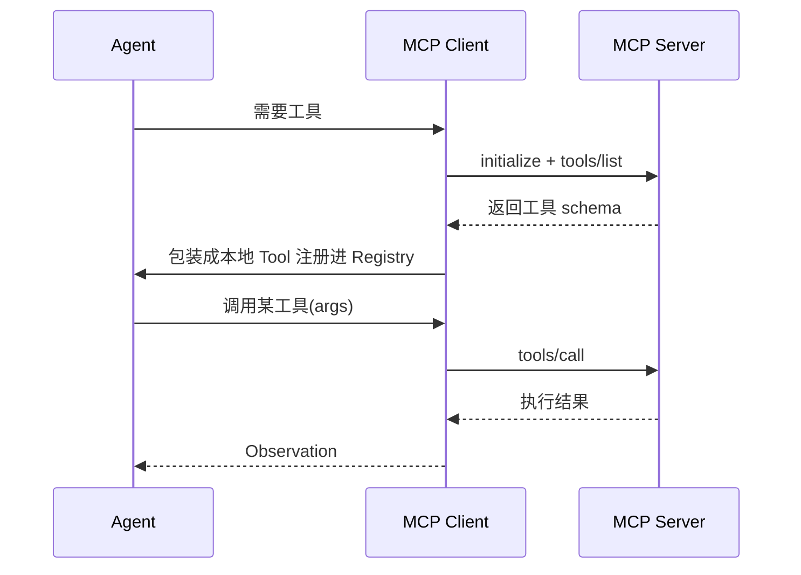

# K09 工具与外部集成 MCP（Model Context Protocol）（对应执行阶段 P5，前置 K3）

> 本章讲如何让 Agent "长出"任意外部能力：用一套标准协议（MCP）把远端工具/资源/提示接进来，而不必为每个系统写专用适配。学完进入 `项目教学区_Labs/L09_工具与外部集成/` 把 MCP server 的工具桥接进 Agent。

## 一、学习目标
1. 说清 MCP 是什么、解决什么痛点（工具接入标准化、解耦）；
2. 讲出协议三原语 tools / resources / prompts 与核心方法 `initialize` / `tools/list` / `tools/call`；
3. 画出 Agent ↔ MCP client ↔ MCP server 的接入时序；
4. 解释 MCP 与 K3 Function Calling 的关系（传输层 vs 调用协议，入口不同落点相同）；
5. 在 L9 把（最小）MCP server 的 tool 经 bridge 注册进 Agent 的 `ToolRegistry`，让主循环无感调用。

## 二、核心概念（概念卡）
- **Model Context Protocol（MCP）**：Agent 与外部系统之间的开放协议，统一"怎么发现工具、怎么调用、怎么取资源/提示"。2024–2025 由 Anthropic 提出并迅速成生态标准。
- **MCP Server / Client**：server 暴露能力（工具/资源/提示），client（通常在 Agent 侧）连接并调用。
- **三原语**：`tools`（可执行的动作，带 schema）、`resources`（只读上下文，如文件/数据库快照）、`prompts`（可复用的提示模板）。
- **核心方法（JSON-RPC）**：`initialize`（握手）、`tools/list`（列出工具 schema）、`tools/call`（执行某工具）。
- **Transport（传输）**：`stdio`（本地子进程，零网络）、`SSE` / `streamable HTTP`（远程）。本地优先选 stdio，跨机用 HTTP。
- **与 K3 的关系（必讲）**：K3 的 Function Calling 是"**模型如何调工具**"的协议；MCP 是"**工具从哪来、怎么传**"的传输层。本地工具直接进 `ToolRegistry`，远端工具经 MCP 进来——入口不同，**落点相同**，Agent 主循环无感。

## 三、工作原理



伪代码（bridge）：

```
def bridge(server):
    client = MCPClient(server)
    client.initialize()
    schemas = client.list_tools()          # 拿到远端工具 schema
    for s in schemas:
        registry.register(wrap_as_local_tool(s, client))  # 翻译成本地 Tool
```

## 四、主流方案与 2025–2026 实务
- **MCP 成工具接入标准**：2025 大量 SaaS/数据库/IDE 提供官方 MCP server，Agent 即插即用，告别"每系统一套 SDK"。（平台侧也把内部工具暴露为 MCP 服务，见后续工程实践。）
- **三原语分工**：tools 干动作、resources 供上下文、prompts 供模板——比"只有工具"更完整。
- **Transport 选择**：本地工具/CLI 用 `stdio`（简单、安全、无网络）；远程多租户用 `SSE/streamable HTTP` + 鉴权。
- **与 A2A 区分**：MCP 是"Agent↔工具/资源"，A2A 是"Agent↔Agent"；别混。
- **与 K8 RAG 关系**：检索本身可暴露成 MCP `tool`（如 `search_kb`），RAG 能力即被标准化接入（呼应 K8）。
- **与 K7 多智能体**：编排者调度的"角色能力"也可经 MCP 引入，能力来源统一。
- **Auth / 权限边界**：远端工具带副作用，必须鉴权与最小权限——绝不能把高危操作无守卫暴露。

## 五、常见陷阱
1. **把 MCP 当"又一个工具框架"**——忽视其"统一接入/解耦"价值：核心价值是标准化，不是又一种调用方式。
2. **Transport 选错**——本地硬上 HTTP 徒增攻击面；远程却用 stdio 不可达。
3. **远端 schema 与本地校验脱节**——`tools/list` 的 schema 没映射到本地 `Tool.schema`，参数清洗失效。
4. **忽略 auth/权限边界**——把带写操作的远端工具无守卫暴露给 Agent。
5. **把本地工具硬改写成 MCP**——本地工具直接进 Registry 即可，不必为"用 MCP"而 MCP。

## 六、自检题
1. 一句话区分 MCP 与 K3 的 Function Calling。
2. MCP 三原语 tools/resources/prompts 各解决什么？
3. 何时用 stdio transport，何时用 HTTP？
4. 为什么远端工具必须做鉴权与最小权限？
5. （开放题）设计一个"天气 MCP server"：① 它的 `tools/list` 应返回什么 schema（参数/描述）；② Agent 侧 bridge 如何把它注册成 `Tool`；③ 若 server 在远程、需要 API Key，接入时要注意什么（传输/auth/超时）。

## 七、动手引子
→ 进入 `项目教学区_Labs/L09_工具与外部集成/`（可对照 `tutorial/code/mcp_demo` 看真实 stdio 实现）：
- 运行 `python loop.py` 看 **最小 MCP server（含 weather 工具）→ MCPBridge 接入 Agent 的 ToolRegistry → Agent 主循环无感调用**；
- 打开 `mcp_server.py` / `mcp_bridge.py`：协议三原语与"翻译成本地 Tool"的核心；
- `pytest test_mcp.py` 验收 list_tools / 注册 / 调用转发。
> 关键认知：MCP 是"工具从哪来"的传输层，K3 FC 是"怎么调"——远端工具经 MCP 进来后，和本地工具一样落在 `ToolRegistry`，Agent 主循环根本分不清。这就是解耦的价值。
