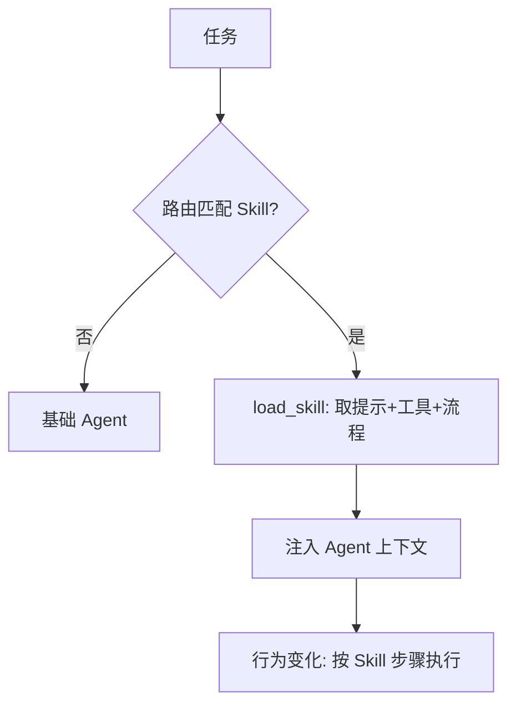

# K10 能力模块 Skill（执行阶段 P5，前置 K9）

> 本章讲如何把"某类任务怎么做"固化为可复用单元：Skill = 提示片段 + 绑定工具 + 步骤模板，按需加载注入 Agent。它与 K3 的 FC、K9 的 MCP 处在**不同层**。学完进入 `项目教学区_Labs/L10_能力模块(Skill)/` 用 `tutorial/code/skill_demo` 的真实 Skill 做按需加载。

## 一、学习目标
1. 定义 Skill（一组提示 + 工具 + 流程的封装），说出它与 FC/MCP 的分层关系；
2. 实现 Skill 的注册、发现/路由、按需加载（lazy loading）与注入；
3. 解释 lazy loading 为何省上下文（呼应 K2 lost-in-the-middle）；
4. 列举 2025–2026 实务（平台级 Skill/Plugin 机制、版本化、与 Multi-Agent 的边界）；
5. 在 L10 让 Agent 遇到匹配任务时按需加载 Skill，注入后行为变化、不加载时不占上下文。

## 二、核心概念（概念卡）
- **Skill（能力封装层）**：把"某类任务怎么做"固化为可复用单元——含 system 提示片段 + 绑定工具 + 步骤模板。是**能力的组织方式**，而非能力来源。
- **发现 / 路由（Discovery / Routing）**：按任务名或语义找到该加载哪个 Skill。
- **Lazy Loading（按需加载）**：只在匹配任务出现时才把 Skill 提示/工具注入上下文，平时不占窗口——直接对抗 K2 的 lost-in-the-middle。
- **版本化**：Skill 有版本，避免无描述/无版本导致误加载（陷阱④）。
- **三层关系（必讲）**：K3 **FC** 是"模型调工具的协议层"；K9 **MCP** 是"工具从哪来的传输层"；K10 **Skill** 是"能力怎么被组织、被发现、被按需调用"的封装层。三者分层：FC 管"怎么调"，MCP 管"从哪来"，Skill 管"何时用、怎么组织"。

## 三、工作原理



伪代码：

```
registry.register(Skill(name, trigger, system_prompt, tools, steps))
def route(task):
    skill = registry.match(task)        # 发现/路由
    if skill: return inject(agent, skill)   # 按需加载并注入
    return agent
```

## 四、主流方案与 2025–2026 实务
- **三层分工明确**：FC（K3）让模型能调工具、MCP（K9）把任意外部系统接进来、Skill（K10）把"接进来的能力"按领域组织成可发现、可加载的单元。L10 之后 `agent_core` 的 `ToolRegistry` 同时承载本地工具(K3)、MCP 远端工具(K9)、Skill 绑定工具(K10)——设计_docs 称其为"工具接入主线的代码落点"。
- **平台级 Skill/Plugin**：2025 主流 Agent 平台都内置"技能/插件"市场（提示模板 + 工具 + 工作流），按需启用；核心理念就是 lazy loading + 路由。
- **与 Multi-Agent（K7）的边界**：Skill 是"单 Agent 的能力插件"，不是独立角色；若把 Skill 做得过大、自带调度，就退化成"另一个 Agent"——应拆回多角色（陷阱②）。
- **与 RAG（K8）的区别**：RAG 提供"检索到的知识片段"注入上下文；Skill 提供"做某类任务的流程与方法"注入上下文。一个补知识、一个补方法。
- **版本化与误加载**：Skill 必须带名称/触发条件/版本；否则路由错配会污染行为（陷阱④）。
- **与基础 system 不冲突**：Skill 提示应是基础 system 的"增量"，叠加而非覆盖（陷阱③）。

## 五、常见陷阱
1. **Skill 与 MCP 混为一谈**——MCP 解决"外部能力怎么连"，Skill 解决"连进来后怎么组织/按需调用"；层不同。
2. **Skill 过大变成"另一个 Agent"**——失去"轻量插件"优势，应拆成多角色(K7)。
3. **Skill 提示与基础 system 冲突**——应增量叠加，避免覆盖核心指令。
4. **Skill 无版本/无描述导致误加载**——路由错配，行为污染。
5. **常驻不卸载**——不 lazy loading 就失去省上下文的意义（呼应 K2）。

## 六、自检题
1. 用一句话区分 FC、MCP、Skill 三层。
2. 为什么 Skill 要 lazy loading 而非常驻？
3. Skill 与 Multi-Agent 的边界在哪？何时该用 Skill、何时该拆多角色？
4. Skill 与 RAG 注入上下文的内容有何本质不同？
5. （开放题）设计一个"报销 Skill"：① 它绑定哪些工具、含哪些步骤；② 触发条件怎么写才不误加载；③ 如何版本化以避免旧流程导致错误打款。

## 七、动手引子
→ 进入 `项目教学区_Labs/L10_能力模块(Skill)/`（可对照 `tutorial/code/skill_demo` 看真实 Skill 定义）：
- 运行 `python loop.py` 看 **任务路由 → 按需 load_skill → 注入提示+工具 → Agent 行为变化**；不匹配时不加载、不占上下文；
- 打开 `skill_loader.py`：Skill 注册/路由/加载注入的核心；
- `pytest test_skill.py` 验收路由匹配、注入后工具可用、不匹配时不加载。
> 关键认知：Skill 是"能力的组织层"，不是能力来源——它和 K3 FC（协议）、K9 MCP（传输）分层协作。lazy loading 让它既不常驻污染上下文，又能在需要时立刻赋能 Agent。
