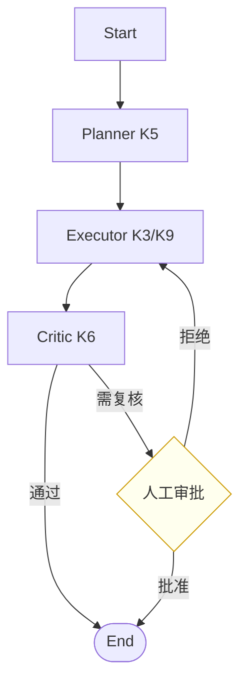

# K11 编排与框架（执行阶段 P6，前置 K7/K10）

> 本章把 K1–K10 的能力模块（工具/记忆/规划/反思/多智能体/RAG/MCP/Skill）**串成流水线**：用图/状态机声明式编排、checkpoint 断点续跑、human-in-the-loop 人工回环，并对照 LangGraph。学完进入 `项目教学区_Labs/L11_编排与框架/` 用纯 Python 图引擎落地。

## 一、学习目标
1. 区分**声明式编排**（图/状态机）与命令式硬编 if/for；说出何时该上图；
2. 实现最小图编排器：节点(Node)、边(Edge)、条件流转、checkpoint 持久化与恢复；
3. 理解 human-in-the-loop 为何是生产 Agent 的刚需；4. 解释**幂等**为何是重跑/恢复的前提；
4. 对照 LangGraph/AutoGen/CrewAI，知道本 Lab 图引擎与它们的映射；
5. 在 L11 跑通"多步流水线 + 中断恢复 + 人工审批 + 幂等"。

## 二、核心概念（概念卡）
- **Orchestrator（编排器）**：调度各模块的"总控"，决定谁先谁后、何时停、何时等人。
- **Node / Edge**：节点=一个处理单元（可绑定 K3–K10 任一模块）；边=流转（固定或条件）。
- **Checkpoint（检查点）**：把运行状态（当前节点 + 数据 + 已完成列表）落盘，用于断点续跑。
- **Human-in-the-loop（人工回环）**：在关键节点暂停，等人工输入再继续——护栏与可审计的支点。
- **幂等（Idempotent）**：同一操作执行多次与一次效果相同；恢复时重跑已完成的节点不能有重复副作用。
- **声明式 vs 命令式**：声明式"描述流程是什么"，引擎驱动；命令式"用 if/for 写死步骤"。前者易改、易观测、易恢复。

## 三、工作原理



伪代码：

```
graph = Graph(start)
graph.add(Node("planner", run=K5.planner))
graph.add(Node("executor", run=K3.tool_exec, next="critic"))
graph.add(Node("critic", run=K6.reflect, next_by=lambda s: "human" if needs else END))
graph.add(Node("human", run=approve, human=True))

state, status = graph.run(checkpoint="cp.json")   # 执行并落盘
if status == PAUSED_FOR_HUMAN:
    state, status = graph.run(state, human_input={"ok": True})  # 恢复
```

## 四、主流方案与 2025–2026 实务
- **LangGraph**：最主流的"图编排"框架——StateGraph、节点即函数、条件边、内建 checkpoint（Memory/Postgres/S3）、human-in-the-loop 一等公民。本 Lab 的 `Graph/Node/checkpoint` 是它的极简内核映射。
- **AutoGen / CrewAI**：AutoGen 偏"对话式多 Agent 编排"；CrewAI 偏"角色化流水线"。本 Lab 的节点可替换为 L07 的多角色 Agent。
- **图 vs 硬编 if/for**：流程固定且简单→if/for 更直观；流程多分支、要恢复、要观测、要热改→图更优（design_docs：K11 前不引入重框架，纯 Python 图足够）。
- **与 K5 Plan-and-Execute 的区别**：Plan 是**单 Agent 内部**的任务拆解；Orchestrator 是**跨模块/跨 Agent** 的调度骨架——前者是"怎么想清楚一步棋"，后者是"怎么把多个棋子按规则走完"。
- **幂等是恢复的命门**：checkpoint 恢复时，已完成节点必须跳过副作用（如"扣款"不能因重跑再扣一次）。L11 用 `done` 列表保证节点幂等。
- **可观测（K12）钩子**：每个节点进出、checkpoint 落盘都是天然轨迹点，便于 K12 评估/回放。

## 五、常见陷阱
1. **把编排当万能胶**：图只管"谁先谁后"，模块内部逻辑（K3–K10）仍要扎实；编排救不了烂模块。
2. **忽略幂等**：重跑已执行节点产生重复副作用（重复发邮件、重复扣款）。
3. **无 checkpoint 不可恢复**：进程崩了只能从头跑，长流程不可承受。
4. **过度编排**：简单线性三步硬编 if/for 即可，上图反而增复杂度。
5. **人工节点无超时/无审计**：human-in-the-loop 要记录"谁、何时、批了什么"，否则不可问责。

## 六、自检题
1. 图编排相比硬编 if/for 的三大好处？何时不该上图？
2. 为何 checkpoint 是断点续跑的前提？checkpoint 该存哪些状态？
3. 什么是幂等？恢复时若不幂等会发生什么？
4. K5 Plan-and-Execute 与 K11 Orchestrator 的本质区别？
5. （开放题）设计"报销审批流"图：① 节点含 提交→合规校验→主管审批(人工)→财务打款；② 财务打款节点如何保证幂等（防重复打款）；③ 在哪个边加 checkpoint 最划算；④ 主管驳回时如何回到"提交"节点（回边）。

## 七、动手引子
→ 进入 `项目教学区_Labs/L11_编排与框架/`：
- `orchestrator.py`：最小图引擎（Node/Graph/checkpoint/human/幂等）；
- `loop.py`：把 Planner→Executor→Critic→人工审批串成流水线，演示中断恢复；
- `pytest test_orchestrator.py` 验收跑通/暂停/恢复/幂等。
> 关键认知：编排是"能力的调度骨架"，不是能力本身；checkpoint + 幂等 + 人工回环，是它从玩具走向生产的三个支点。
