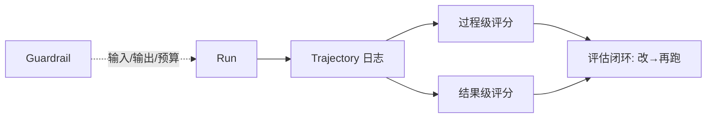

# K12 评估/可观测/安全（执行阶段 P6，前置 K11）

> 本章给 Agent 加"仪表盘与刹车"：过程级评估、轨迹回放、自动评分、护栏（输入/输出/权限/预算）。它是 P6 的收口，也让前面 K1–K11 的产物可被度量与约束。学完进入 `项目教学区_Labs/L12_评估与安全/` 用纯 Python 做评估面板。

## 一、学习目标
1. 区分**过程级 vs 结果级评估**，说出为何过程级更重要；
2. 用轨迹（Trajectory，K11 已产出）做回放与自动评分；
3. 实现分层护栏（输入过滤 / 输出过滤 / 权限 / 预算）；
4. 理解可观测（trace/log）为何是生产 Agent 的刚需；
5. 在 L12 跑通"记录轨迹→过程/结果打分→护栏拦截危险输入/超预算截断"。

## 二、核心概念（概念卡）
- **过程级评估（Process Eval）**：评估"每一步走没走对"——是否调对工具、是否核实、是否绕路。抓的是**路径质量**。
- **结果级评估（Outcome Eval）**：只看最终答案对不对/满不满意。抓的是**终点质量**。
- **Trajectory（轨迹）**：整轮运行的步骤序列（thought/action/observation），是评估与回放的证据（K11 的 `Trajectory`）。
- **Guardrail（护栏）**：在输入/输出/权限/预算层设防，兼顾安全与可用。
- **可观测性（Observability）**：trace/log 让"黑箱"变白箱，便于调试与问责。
- **评估闭环**：跑 → 记轨迹 → 评分 → 改提示/流程 → 再跑。

## 三、工作原理



伪代码：

```
traj = agent.run(goal, guardrail=input_filter, budget=max_steps)
process_score = score_process(traj)     # 每步是否合理
outcome_score = score_outcome(traj, goal) # 最终是否满足
guardrail.check_output(traj.final_answer) # 输出护栏
```

## 四、主流方案与 2025–2026 实务
- **LLM-as-judge**：用强模型给轨迹/答案打分（过程+结果），是 2025–2026 主流自动评估法；本 Lab 用规则评分，但接口可换成 LLM 评委。
- **可观测平台**：LangSmith / Langfuse / Arize 提供轨迹回放、成本、延迟、评估面板——本 Lab 的 `Trajectory` 正是它们的数据底座（K11 checkpoint 的轨迹点可直接喂入）。
- **护栏框架**：输入侧挡 prompt injection / 危险指令；输出侧挡 PII/密钥泄露；权限侧限工具范围；预算侧限步数/成本/token。2025 红队（red-teaming）已成上线前标配。
- **过程级为何更重要**：结果对可能"蒙对"，但过程错（绕路、误调工具、未核实）在长任务里会累积成灾难；且过程级能定位**哪一步**烂，便于改（呼应 K5 可验证子目标、K6 反思）。
- **与 K11 复用**：编排器的节点进出 + checkpoint 已是天然轨迹点，K12 直接消费，闭合 P6。
- **成本/预算不可省**：无 token/成本计量，生产无法控费；本 Lab 用 `CostMeter` 估算。

## 五、常见陷阱
1. **只看结果分忽略过程**：蒙对一次掩盖系统性路径错误。
2. **护栏过严不可用**：一刀切拦截导致正常请求也被挡；应分级（警告/拦截）。
3. **无成本/无预算**：长流程跑飞，账单爆炸。
4. **无回放难调试**：只存最终答案，出问题无法复现。
5. **评估集污染**：用训练/开发同源数据自卖自夸，评估失真。

## 六、自检题
1. 为何过程级评估比结果级更重要？举一个"结果对但过程烂"的例子。
2. 护栏如何兼顾安全与可用（避免过严不可用）？
3. 评估闭环怎么形成？轨迹在其中起什么作用？
4. 预算（步数/成本）为何是生产 Agent 的必选项？
5. （开放题）为"客服 Agent"设计评估与护栏：① 过程指标（是否调知识库/是否核实身份/是否升级人工）；② 结果指标（解决率/满意度）；③ 护栏（拒泄露用户 PII、限每日外呼次数、挡诱导转账）。

## 七、动手引子
→ 进入 `项目教学区_Labs/L12_评估与安全/`：
- `eval_panel.py`：Guardrail（输入/输出/预算）+ CostMeter + 过程/结果评分；
- `loop.py`：跑 Agent 并演示护栏拦截危险输入、超预算截断、轨迹打分；
- `pytest test_eval.py` 验收过程/结果评分 + 护栏拦截 + 预算截断。
> 关键认知：评估是"让 Agent 可被度量"，护栏是"让 Agent 可被信任"；二者 + K11 轨迹，把玩具变成可上线系统。
