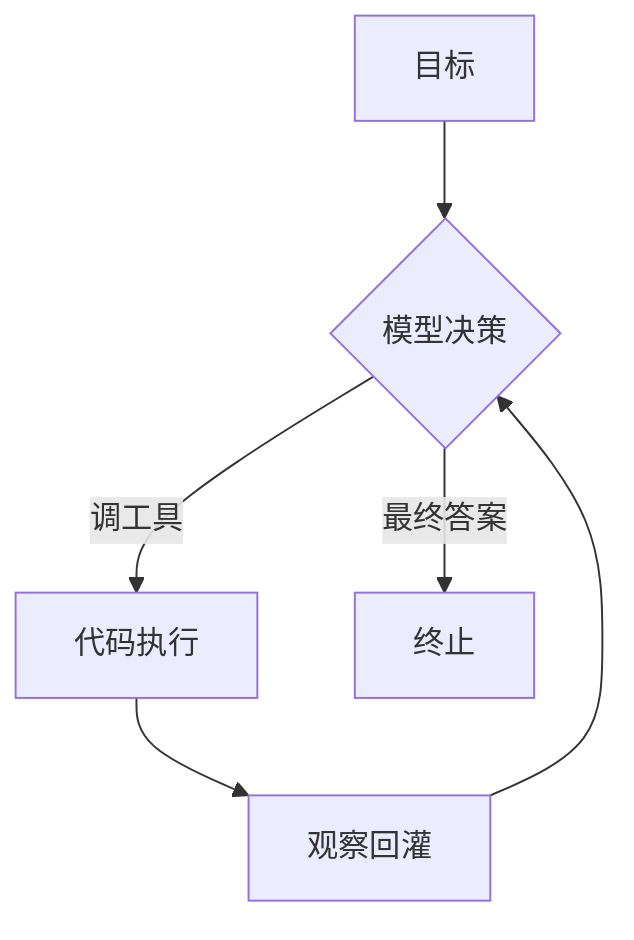

# L01 最小 Agent Loop（对应 K1）

## 目标
一句话：跑通一个会"思考→行动→观察"循环并正确终止的 Agent。
能力目标：理解并实现 Agent Loop 主循环原理。

## 前置
- 已完成：`文字教学区_Theory/K01_概念与定义/`（K1 理论章）
- 依赖：Python 3.11+；**无需 API Key**（默认用 `MockLLMClient` 离线决策器）

## 实现步骤
1. 读 `agent_core/agent.py` 的 `Agent.run`：它就是最小闭环。
2. 读 `agent_core/llm.py`：`LLMClient` 抽象 + `MockLLMClient`（离线决策器）+ 成本护栏。
3. 读 `tools_basic.py`：`CalculatorTool` 如何被注册与分发。
4. 运行 `python loop.py` 看轨迹。

## 闭环示意

`loop.py` 现在演示两种轨迹：① 单步（"算 23*17"一步出答案）；② **多步循环**（`demo_multi_step`：先算正方形面积、再据观察终止），直观看到 Agent 不是"一次函数调用"，而是反复决策—执行—回收的闭环。

## 验收标准
- [ ] 给定目标能自主循环 ≤N 步并终止（含多步示例）
- [ ] 轨迹可读，含 Thought / Action / Observation
- [ ] `pytest test_loop.py` 全绿

## 运行
```bash
cd 项目教学区_Labs/L01_最小AgentLoop
python loop.py
pytest test_loop.py
```

## Reflection（回扣理论）
见 `reflection.md`。
