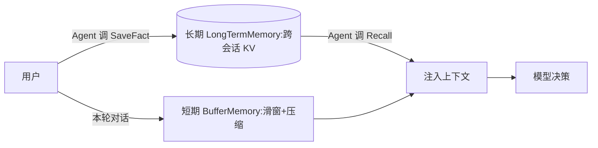

# L04 记忆模块（对应 K04）

> 用 `agent_core` 的 `Memory` 抽象，把 K4 的"分层记忆"落成可运行代码：跨会话长期记忆 + 短期压缩。无需 API Key。

## 目标
- 理解"上下文窗口 ≠ 记忆"：第二次对话时上下文里没有第一次的话，Agent 靠**检索长期记忆**才"记得"。
- 跑通两种记忆：① 跨会话长期记忆（`LongTermMemory`，两次 `run` 共享 store）；② 短期压缩（`BufferMemory` 超限折叠）。
- 体会 agentic memory：记忆的**写入/读取是 Agent 通过工具显式完成的**，而非工程师全塞上下文。

## 记忆分层示意


## 实现步骤
1. `agent_core/memory.py` 提供 `BufferMemory`（短期，自动 compaction）与 `LongTermMemory`（长期，KV + 离线语义召回）。
2. `memory_tools.py` 把长期记忆包成两个工具：`SaveFact`（写）、`Recall`（读）。Agent 通过 Function-Call 风格的动作调用它们。
3. `loop.py` 的 `MemoryMock` 是离线决策器：看到"我叫X"就存、看到"叫什么"就召回、看到工具结果就给最终答案。

## 运行
```
cd 项目教学区_Labs/L04_记忆模块
python loop.py
```
将看到：
- 会话1 "我叫小明" → 写入长期记忆；
- 会话2 "我刚才说我叫什么？" → 从长期记忆召回 → "你叫小明"（上下文里本没有会话1的话）。

## 验收标准
- [ ] 能解释为什么第二次 run 能"记得"第一次的名字（长期记忆检索注入）。
- [ ] `pytest test_memory.py` 全绿：save/recall 正确、compress 减少条数、跨会话 Agent 召回成功。
- [ ] 能说出短期记忆为什么要压缩（lost-in-the-middle + 成本）。

## 技能演练（亲手做）
打开 `agent_core/memory.py` 的 `LongTermMemory.recall`：当前是"精确匹配 + 子串回退"的离线近似。把它升级为**真实语义召回**——接入 `sentence-transformers` 或向量库（Qdrant），把 `save_fact` 时同步写 embedding，召回时 cosine top-k。这就是 K4 说的"真实用 embedding + 向量库"。改完后跑 `test_memory.py` 验证老用例仍过。
