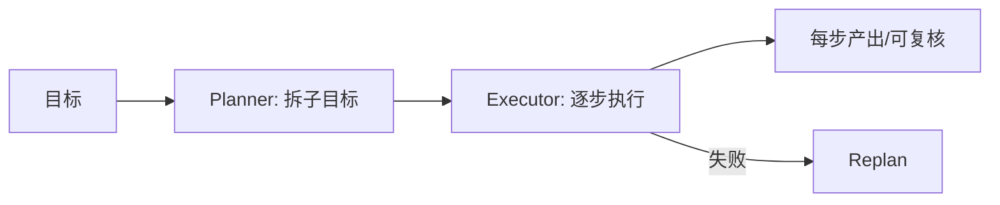

# L05 推理与规划（对应 K05）

> 把 K5 的"规划 vs 边想边做"落成代码：一个解耦的 Plan-and-Execute 骨架，并与 ReAct 对照。无需 API Key。

## 目标
- 理解 ReAct（单 loop 边想边做）与 Plan-and-Execute（先出计划再逐步执行）的结构差异。
- 体会"规划与执行解耦"：Planner 只负责拆子目标，Executor 只负责逐步跑，执行单元可插拔（真 Agent/工具/函数）。
- 认识推理模型的边界：它强化单步推理，但多步编排仍需这里的规划层。

## 结构示意


## 实现步骤
1. `planner.py`：`Planner(ABC)` + `MockPlanner`。`plan(goal)` 把含"并/然后"的复合目标拆成多步，否则给"理解/执行/复核"三步。
2. `executor.py`：`PlanExecutor(step_fn)`，按 plan 逐步调用执行单元 `step_fn(step)`，收集结果。
3. `loop.py`：对照演示——`demo_plan_and_execute`（先 plan 后执行）与 `demo_react`（直接用 `agent_core.Agent` 的 ReAct loop）。

## 运行
```
cd 项目教学区_Labs/L05_推理与规划
python loop.py
```
将看到：Plan-and-Execute 先打印计划再逐步执行；ReAct 在单循环内完成。

## 验收标准
- [ ] 能口述 ReAct 与 Plan-and-Execute 的差异与适用场景。
- [ ] `pytest test_plan.py` 全绿：复合目标被拆成多步、默认三步、执行器跑完所有子目标。
- [ ] 能说明推理模型（o1/o3/R1）为何不替代规划层。

## 技能演练（亲手做）
1. 把 `MockPlanner` 换成**真 LLM planner**：让 `OpenAIClient` 充当 planner，prompt 要求"输出 JSON 步骤数组，每步含 `goal` 与 `verify`（可验证产出描述）"。这直接对应 K5"可验证子目标"。
2. 给 `PlanExecutor` 加 `replan`：某步执行失败时，基于已完成结果重新调用 planner 生成剩余步骤（对应 K5 陷阱②不 replan）。改完跑 `test_plan.py` 验证老用例仍过。
