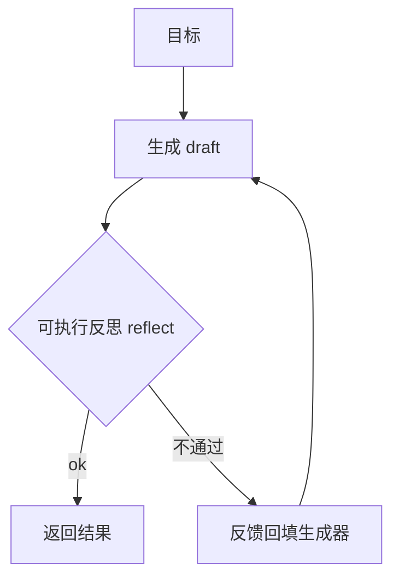

# L06 反思与自评（对应 K06）

> 把 K6 的"反思闭环"落成代码：用真实 `compile` 做可执行反思，跑通"含错代码 → 自检 → 修正"。无需 API Key。

## 目标
- 理解反思/自评为什么必要：单 pass 产出不可靠，需"生成→批评→修正"闭环。
- 体会**可执行反馈**比语言反馈可靠：本 Lab 用 `compile` 给出确定信号，而非让模型嘴上说"改好了"。
- 认识收敛条件：必须 `max_iter` 上限，防止反思空转不收敛。

## 反思闭环示意


## 实现步骤
1. `reflector.py`：`Reflector.reflect(code)` 用 `compile` 真实校验语法，返回 `(ok, feedback)`——确定信号。
2. `self_correct_loop.py`：`SelfCorrectLoop` 反复 生成→反思→不通过则把 feedback 回填生成器再生成，直到 ok 或 `max_iter`。
3. `loop.py`：离线 `mock_generator` 首轮故意语法错，收到 `SyntaxError` 反馈后产出修正版，演示闭环收敛。

## 运行
```
cd 项目教学区_Labs/L06_反思与自评
python loop.py
```
将看到：首轮代码语法错 → 反思报 SyntaxError → 回填 → 次轮修正版通过，收敛轮数=2。

## 验收标准
- [ ] 能口述"可执行反馈 vs 语言反馈"的差异。
- [ ] `pytest test_reflect.py` 全绿：正确/错误代码判定、自我修正 2 轮收敛。
- [ ] 能说明为什么反思循环必须设 `max_iter` 上限。

## 技能演练（亲手做）
1. 把"语法反思"升级为"运行反思"：用 `exec` 在沙箱里真正执行代码，捕获运行时异常/断言失败作为可执行反馈（比 compile 更强）。
2. 接真 LLM：把 `mock_generator` 换成 `OpenAIClient` 驱动的生成器，prompt 要求"根据反馈修正代码"；把 `Reflector` 也加一层 LLM-as-judge（但记住 judge 也会错，K6 陷阱⑤）。
3. 把"常见错误→修正"写入 `agent_core.LongTermMemory`（呼应 K4/Reflexion）：下次生成前先 `recall` 历史教训，避免重蹈——闭合"反思→记忆"链路。
