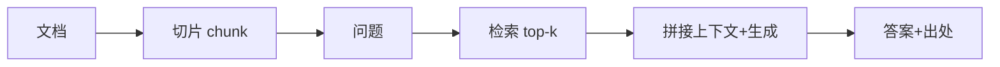

# L08 检索增强生成 RAG（对应 K08）

> 把 K8 的"检索→注入→接地生成+出处"落成代码：离线用 BM25 近似检索，跑通切片→检索→生成+标注出处全流程。无需 API Key。

## 目标
- 理解 RAG 两阶段：离线建库（切片）、在线检索注入（检索→生成+出处）。
- 体会"检索注入"与 K4 记忆同构：一个查外部语料、一个查自身经验，都是检索→注入。
- 认识出处标注：答案带来的 chunk id/source 是可审计的证据链，缺失则幻觉难查。

## 流程示意


## 实现步骤
1. `indexer.py`：`Indexer.build(docs)` 按句切片建成内存 chunk 库（真实应 embedding 入向量库）。
2. `retriever.py`：`Retriever.retrieve(query, k)` 用 BM25 近似（中文字/英文词交集）做离线 top-k（真实应为 embedding + 向量库 + hybrid）。
3. `generator.py`：`Generator.generate` 把命中 chunk 拼接并标注 `[id:source]`，离线模板演示 grounded generation。

## 运行
```
cd 项目教学区_Labs/L08_检索增强生成
python loop.py
```
将看到：建库 chunk 数 → 检索到相关片段（带 id/source）→ 生成答案附带来源标注。

## 验收标准
- [ ] 能口述 RAG 两阶段与"检索注入"机制。
- [ ] `pytest test_rag.py` 全绿：切片、检索相关性、出处标注。
- [ ] 能说明出处标注为何不可或缺（陷阱③）。

## 技能演练（亲手做）
1. 把离线检索升级为**真实向量检索**：用 `sentence-transformers` 给 chunk 与 query 嵌向量，存进 `Qdrant`/内存向量表，cosine top-k；并加 **hybrid**（BM25 + 向量融合）与 **cross-encoder rerank**（取 20 精排到 3）。
2. 加 **query rewrite / HyDE**：检索前用 LLM 把问题改写成更利于检索的表述（呼应 K8）。
3. 把 RAG 接成 **Agentic RAG**：让 K7 的 Orchestrator 决定"何时检索、检索什么"，把 K4 记忆与 K8 RAG 统一为"检索→注入"双源——闭合全链路。
