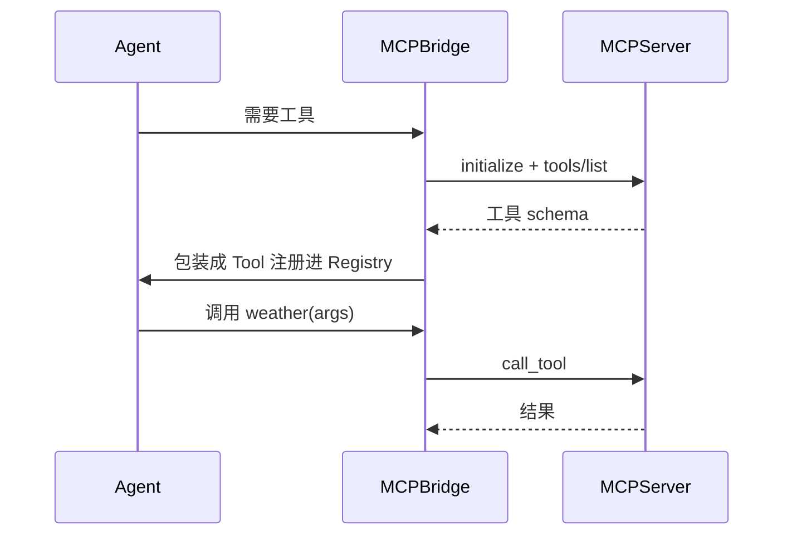

# L09 工具与外部集成 MCP（对应 K09）

> 把 K9 的"工具统一接入"落成代码：最小 MCP server 暴露 weather 工具，MCPBridge 把它翻译成本地 `Tool` 注册进 Agent 的 `ToolRegistry`，主循环无感调用。离线可跑；真实 stdio 实现可对照 `tutorial/code/mcp_demo/`。

## 目标
- 理解 MCP 是"工具从哪来"的**传输层**，K3 的 Function Calling 是"怎么调"——入口不同、落点相同。
- 体会 bridge 的价值：远端工具经 `list_tools` → 翻译 → 注册，和本地工具一样落在 `ToolRegistry`。
- 认识协议三原语（tools/resources/prompts）与核心方法（initialize / tools/list / tools/call）。

## 接入时序（离线近似）


## 实现步骤
1. `mcp_server.py`：`MCPServer` 实现 `initialize` / `list_tools` / `call_tool`（JSON-RPC 方法的离线等价）；`build_demo_server()` 暴露 weather 工具。
2. `mcp_bridge.py`：`MCPBridge.connect()` 握手、`register_into(registry)` 把远端 schema 翻译为本地 `_RemoteTool` 注册。
3. `loop.py`：起 server → bridge 接入 → Agent 用 `MCPMock` 调 weather，主循环无感。

## 运行
```
cd 项目教学区_Labs/L09_工具与外部集成
python loop.py
```
将看到：已注册工具含 `weather`；Agent 调远端工具得到"北京 今天晴…"，与本地工具无差别。

## 验收标准
- [ ] 能口述 MCP 与 K3 Function Calling 的关系（传输层 vs 调用协议）。
- [ ] `pytest test_mcp.py` 全绿：列工具、注册、调用转发。
- [ ] 能说明为什么远端工具也要做鉴权与最小权限（陷阱④）。

## 技能演练（亲手做）
1. 接真实 transport：把 `MCPServer` 改成 stdio/SSE 的 JSON-RPC 实现（对照 `tutorial/code/mcp_demo/`），让 bridge 跨进程连真实 server——体会"同进程近似"与"真实网络"的差异。
2. 补三原语：给 server 加 `resources/list` + `resources/read`（如读本地文件）、`prompts/list`（可复用提示模板），bridge 也支持把它们接入 Agent 上下文。
3. 加 auth/超时：远程 server 需 API Key，bridge 在 `initialize` 携带鉴权、在 `call_tool` 加重试/超时——闭合 K9 陷阱④（权限边界）。
