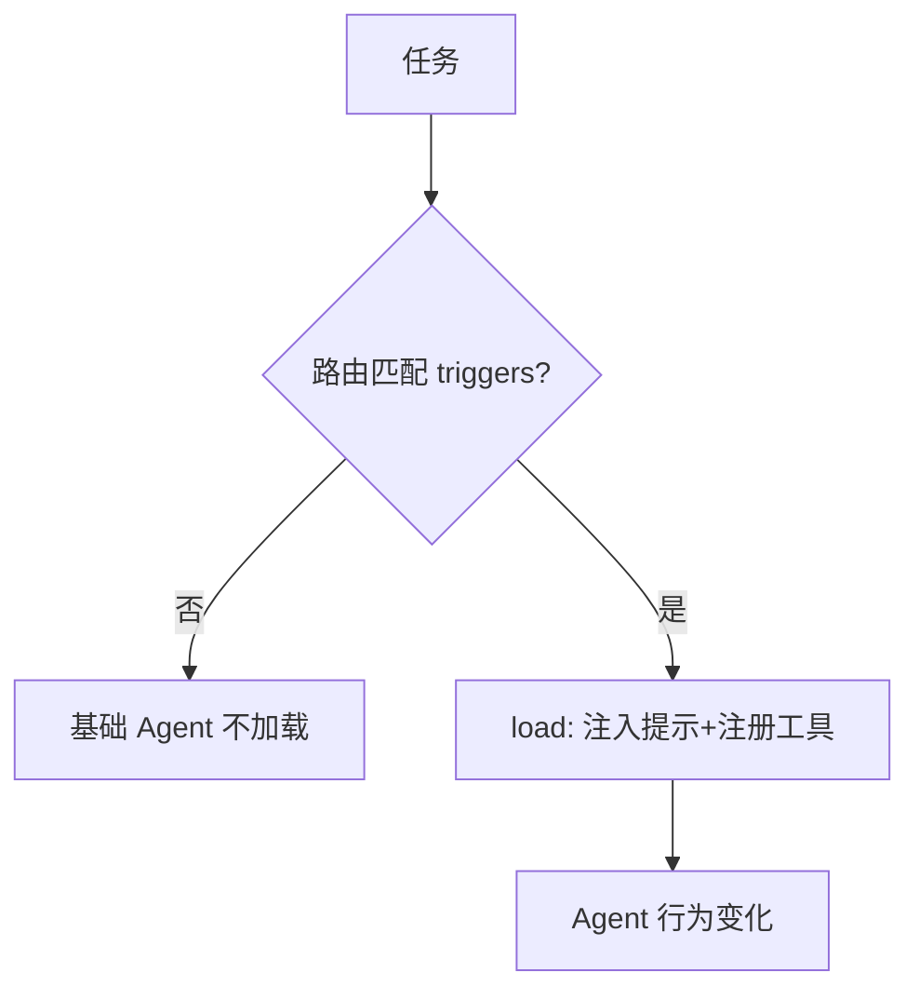

# L10 能力模块 Skill（对应 K10）

> 把 K10 的"能力封装层"落成代码：用 `tutorial/code/skill_demo` 的**真实 Skill**（doc-search），做"路由→按需 load_skill→注入提示+工具→Agent 行为变化"的最小演示。不匹配时不加载、不占上下文。

## 目标
- 理解 Skill 是"能力的组织层"（提示片段 + 绑定工具 + 步骤），与 K3 FC（协议）、K9 MCP（传输）分层。
- 体会 lazy loading：只在匹配任务时注入，平时不占上下文（呼应 K2 lost-in-the-middle）。
- 区分 Skill 与 MCP：MCP 解决"外部能力怎么连进来"，Skill 解决"连进来后怎么组织/按需调用"。

## 流程示意


## 实现步骤
1. `skill_loader.py`：`SkillRegistry` 注册/路由（`match` 按触发词）；`load_from_dir` 解析 `SKILL.md` frontmatter + 动态导入 `handler`，把 `search` 包装成绑定工具；`apply_to_agent` 按需注入提示+工具（lazy loading）。
2. `loop.py`：用 `SkillMock` 演示任务含"查资料"→ 路由命中 → 注入 doc-search Skill → Agent 调 `skill_search`；"天气"任务不匹配 → 不加载。
3. 真实 Skill 来源：`tutorial/code/skill_demo/`（SKILL.md + handler.py + run_skill.py），与本 Lab 共用。

## 运行
```
cd 项目教学区_Labs/L10_能力模块(Skill)
python loop.py
```
将看到：注册 doc-search（触发词 检索/知识库/查资料/找文档）；任务1 匹配并注入、调搜索得 "RAG 先检索再生成…"；任务2 不匹配、基础 Agent 处理。

## 验收标准
- [ ] 能口述 FC / MCP / Skill 三层分工。
- [ ] `pytest test_skill.py` 全绿：路由匹配、注入提示+工具、不匹配不加载。
- [ ] 能说明为何 Skill 要 lazy loading（不常驻省上下文）。

## 技能演练（亲手做）
1. 加第二个 Skill（如 `summarize`），验证多 Skill 路由不冲突；并给 Skill 加 `version` 字段，路由时优先最新版（防误加载，K10 陷阱④）。
2. 把 Skill 的"绑定工具"改成经 **MCP** 进来的远端工具（呼应 K9）：Skill 描述"怎么用"，MCP 描述"从哪来"——体会两层协作。
3. 对比常驻 vs 按需：把同一 Skill 改成常驻注入，跑一个长对话，观察上下文被无关提示稀释（lost-in-the-middle，K2），体会 lazy loading 的价值。
