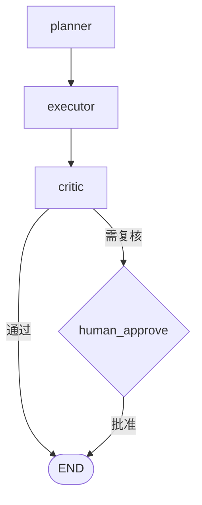

# L11 工作流编排器（对应 K11）

> 把 K11 的"图编排 + checkpoint + 人工回环 + 幂等"落成纯 Python 代码（design_docs：K11 前不引重框架）。节点可替换为 K3–K10 真实模块，把能力串成流水线。

## 目标
- 区分声明式图编排与命令式 if/for；
- 跑通"Planner→Executor→Critic→人工审批"多步流水线；
- 演示 checkpoint 断点续跑、human-in-the-loop 暂停/恢复、幂等防重复副作用；
- 对照 LangGraph（本引擎是其极简内核）。

## 流程示意


## 实现步骤
1. `orchestrator.py`：`Node`（name/run/next/human）+ `Graph`（start/add/run/save/load checkpoint）。`run` 支持人工暂停（PAUSED_FOR_HUMAN）、`human_input` 恢复、`done` 列表保证幂等。
2. `loop.py`：用 Mock 节点演示四节点流水线 + 中断恢复 + 幂等（副作用计数 `_side_effects`）。
3. 各节点与 K 模块的映射（生产替换点）：
   - `planner` → K5 `Planner`
   - `executor` → K3/K9 工具执行（`agent_core.ToolRegistry` / MCPBridge）
   - `critic`  → K6 `Reflector`
   - `human_approve` → K12 护栏（人工回环）

## 运行
```
cd 项目教学区_Labs/L11_编排与框架
python loop.py
```
将看到：① 首次跑到人工节点暂停（done=[planner,executor,critic]，副作用计数 1）；② 注入批准后续跑至 END（副作用仍为 1，已完成节点未重跑）；③ 幂等续跑增量 0。

## 验收标准
- [ ] 能口述图编排 vs 硬编 if/for 的好处。
- [ ] `pytest test_orchestrator.py` 全绿：跑通 / 人工暂停 / checkpoint 恢复 / 幂等。
- [ ] 能说明为何幂等是 checkpoint 恢复的前提。

## 技能演练（亲手做）
1. **加回边**：让 `human_approve` 在"驳回"时回到 `executor`（data 里加 `__next__="executor"`），演示驳回重做——体会图比 if/for 改流程容易。
2. **换真实模块**：把 `planner` 节点替换成 L05 的 `Planner`、`critic` 换成 L06 的 `Reflector`，体会"编排是骨架、模块是血肉"。
3. **持久化后端**：把 `save_checkpoint` 从 JSON 文件换成数据库/对象存储（LangGraph 的 Postgres/S3 checkpoint 思路），体会生产级恢复。
4. **对照 LangGraph**：用 LangGraph 重写同一流程图，标出 `StateGraph`/`add_node`/`add_edge`/`interrupt` 与本引擎的对应关系。
