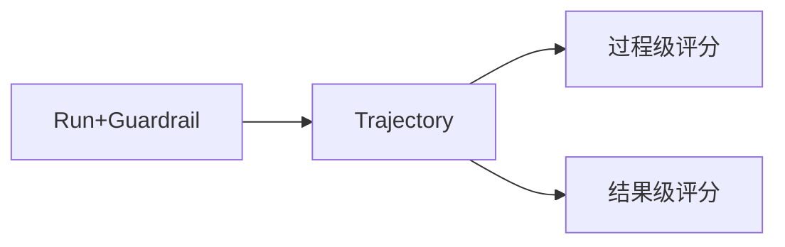

# L12 评估与安全面板（对应 K12）

> 把 K12 的"可度量（评估）+ 可信任（护栏）"落到 K11 产出的 Trajectory 上。纯 Python：护栏（输入/输出/预算）+ 成本计量 + 过程/结果自动评分。

## 目标
- 区分过程级 vs 结果级评估，体会过程级为何更重要；
- 用 Trajectory 做回放与自动评分；
- 实现分层护栏（输入过滤 / 输出泄露 / 预算截断）；
- 对照 LLM-as-judge 与 LangSmith/Langfuse 可观测平台。

## 流程示意


## 实现步骤
1. `eval_panel.py`：`Guardrail`（DANGER_INPUT 拦截危险指令、LEAK_OUTPUT 挡密钥/密码泄露）、`Budget`（max_steps/max_cost）、`CostMeter`（粗略 token 成本）、`score_process`/`score_outcome`。
2. `loop.py`：`DemoLLM`+`SearchTool` 跑 Agent；`guarded_run` 先过输入护栏、预算，再跑、再过输出护栏；三场景演示拦截/截断/打分。
3. 评分接口预留可换成 **LLM-as-judge**（2025–2026 主流自动评估）。

## 运行
```
cd 项目教学区_Labs/L12_评估与安全
python loop.py
```
将看到：① 正常目标通过护栏并打分；② "删除数据库"被 INPUT_BLOCKED 拦截不执行；③ max_steps=1 预算截断、结果分 0。

## 验收标准
- [ ] 能口述过程级 vs 结果级评估的区别与重要性。
- [ ] `pytest test_eval.py` 全绿：护栏拦截/泄露拦截/结果低分/过程高分/预算截断。
- [ ] 能说明护栏如何兼顾安全与可用（分级而非一刀切）。

## 技能演练（亲手做）
1. **换 LLM-as-judge**：把 `score_process/score_outcome` 改成调用强模型给轨迹打分（提示：传 traj.steps 文本给评委模型），体会自动评估升级。
2. **分级护栏**：把 Guardrail 从"拦截/放行"二态改为"警告/拦截"，警告仅记录不阻断，平衡安全与可用（K12 陷阱②）。
3. **接 K11 编排**：把本面板的 `guarded_run` 作为 K11 图的"总闸"节点——编排跑前过输入护栏、每节点后过输出护栏，闭合 P6（K11+K12）。
4. **真实可观测**：把 Trajectory 导出为 Langfuse/LangSmith 兼容格式，体验生产级回放与成本面板。
